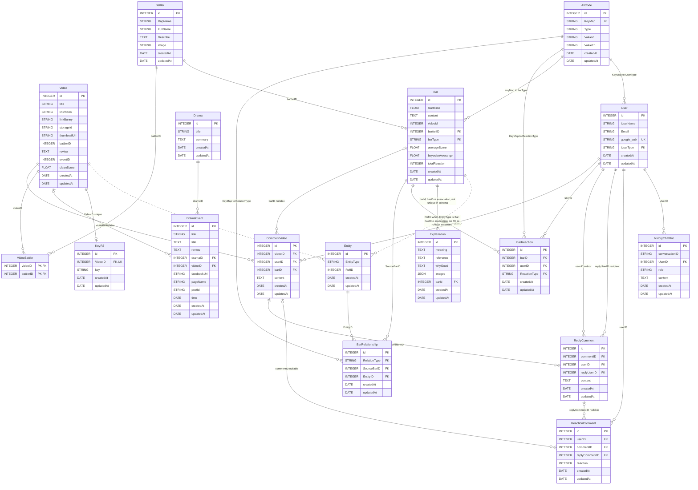

# ERD - BattleRap

Sơ đồ được dựng từ các model Sequelize trong `models/`. Các bảng có `id` và
`createdAt`/`updatedAt` do Sequelize tự sinh được ghi rõ bên dưới; riêng
`VideoBattlers` dùng khóa chính ghép và không có timestamps.

## Ghi chú

- `PK`: khóa chính; `FK`: quan hệ/khóa ngoại được khai báo qua model; `UK`: duy nhất.
- Các cột không ghi `PK` là nullable theo mặc định của Sequelize, trừ khi model
  chỉ định khác.
- `VideoBattler` là bảng nối nhiều-nhiều giữa `Video` và `Battler`.
- `Entity.RefID` là tham chiếu đa hình đến `Video.id` hoặc `Bar.id`, tùy
  `EntityType`; hai liên kết này không có ràng buộc khóa ngoại vật lý.
- `Video.battlerID`, `Video.eventID` và `Bar.videoId` có trong model nhưng không
  được khai báo association trong `models/`, nên không được vẽ thành quan hệ.
